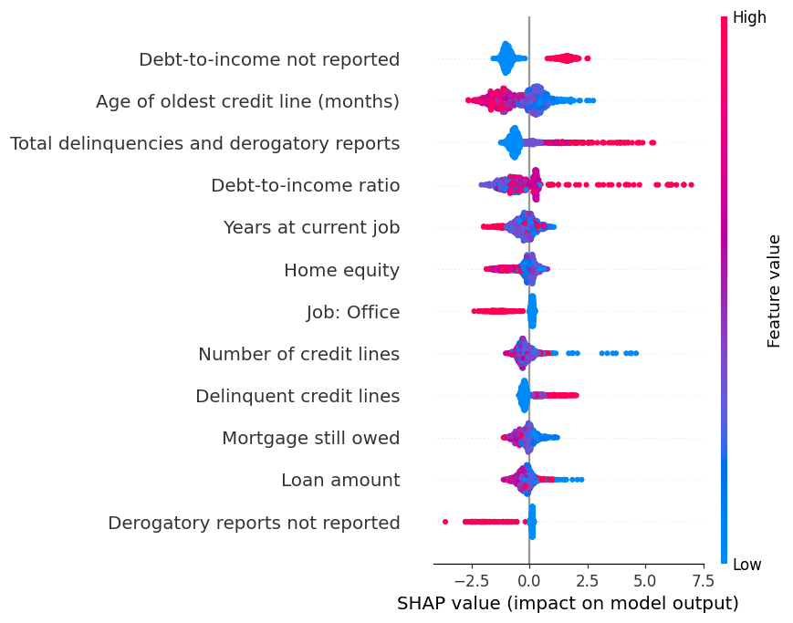

# Explainable Credit Risk and Loan Default Prediction

An end-to-end classical machine learning project that predicts the probability a home-equity loan applicant will default, assigns a risk category, and explains each prediction. It covers data-quality analysis, leakage-safe preprocessing, feature engineering, class imbalance, model comparison, hyperparameter tuning, probability calibration, cost-based threshold selection, SHAP explainability, error analysis and a fairness review, with a Streamlit app on top.

No deep learning, LLMs or external APIs are used. Every number in this README was produced by running the code in this repository.

## Project Overview

A lender must decide whether to approve a loan before it knows whether the borrower will repay. Approving a borrower who later defaults is expensive, while rejecting a reliable borrower loses business. This project builds a model that returns a calibrated default probability so that the decision can be tied to explicit business costs, and shows which factors drove each result.

## Problem Statement

Loan default prediction is difficult for four reasons:

- **Imbalance.** About 20% of applicants default, so accuracy is misleading. Predicting "repaid" for everyone scores about 80% accuracy and catches no defaulters.
- **Informative missing data.** Many fields are blank, and the pattern of blanks carries signal.
- **Unequal error costs.** A missed defaulter costs far more than a rejected good applicant, so the usual 0.5 threshold is rarely right.
- **Probabilities must be trustworthy.** A predicted 30% should mean roughly 30% of such applicants default, which requires calibration.

## Dataset

`data/hmeq.csv` (Home Equity dataset): 5,960 rows, 13 columns, no duplicate rows.

| Column | Meaning (inferred from names and value ranges) |
|---|---|
| BAD | Target. 1 = defaulted or seriously delinquent, 0 = repaid (19.95% positive) |
| LOAN | Requested loan amount |
| MORTDUE | Mortgage amount still owed |
| VALUE | Current property value |
| REASON | DebtCon (debt consolidation) or HomeImp (home improvement) |
| JOB | Job category (Mgr, Office, ProfExe, Sales, Self, Other) |
| YOJ | Years at current job |
| DEROG | Number of major derogatory reports |
| DELINQ | Number of delinquent credit lines |
| CLAGE | Age of oldest credit line, in months |
| NINQ | Number of recent credit inquiries |
| CLNO | Number of credit lines |
| DEBTINC | Debt-to-income ratio |

Key data findings (see `notebooks/01_eda.ipynb`):

- Every predictor except LOAN has missing values. DEBTINC is missing for 21.3% of rows.
- When DEBTINC is missing, 62% of applicants default versus about 9% when it is present. When VALUE is missing, 94% default.
- There is no income, age, gender or race column, so true loan-to-income and credit-utilisation ratios cannot be built.
- The missingness pattern may reflect how the data was collected rather than borrower behaviour. This is a possible leakage-like artifact and is discussed under Limitations.

## ML Pipeline

```
Data (hmeq.csv)
  |
EDA
  |
Stratified 80/20 split (seed 42), test set locked
  |
Pipeline fitted on training folds only:
  Feature engineering -> Imputation / clipping / scaling / encoding -> (SMOTE, tested only) -> Model
  |
Baseline (Logistic Regression)
  |
Model comparison (5-fold stratified CV)
  |
Class imbalance study (none / class weights / SMOTE)
  |
Hyperparameter tuning (GridSearchCV / RandomizedSearchCV, scoring PR-AUC)
  |
Probability calibration (sigmoid vs isotonic, chosen by cross-validated Brier score)
  |
Threshold optimisation (minimum expected cost on cross-validated training predictions)
  |
Explainability (feature importance, permutation importance, SHAP)
  |
Error analysis and fairness review
  |
Final model saved with joblib
  |
Streamlit app
```

**Leakage prevention.** The test set is split off first. Imputers, clippers, scalers, encoders and SMOTE all live inside a scikit-learn/imbalanced-learn `Pipeline`, so cross-validation refits them on each training fold. `reports/leakage_check.csv` shows that the pipeline's learned medians equal the training-only medians and differ from what a fit on all data would learn. Calibration and thresholds are also chosen using only training data, so the test set is used once for the final report.

**Preprocessing details.** Numeric: median imputation, plus 1st/99th percentile clipping and standard scaling for logistic regression only (trees do not need them). Categorical: missing values become their own "Missing" category, then one-hot encoding.

**Engineered features** (`src/feature_engineering.py`):

| Feature | Meaning | Reason |
|---|---|---|
| LTV | Loan / property value | Share of the property at stake |
| MORTGAGE_TO_VALUE | Mortgage owed / property value | Existing leverage |
| TOTAL_LEVERAGE | (Loan + mortgage) / property value | Combined debt against collateral |
| EQUITY | Property value minus mortgage | Cushion if the borrower struggles |
| NEGATIVE_MARKS, HAS_NEGATIVE_MARKS | DEROG + DELINQ and whether it is above zero | Combines related credit-history signals |
| INQUIRIES_PER_LINE | Recent inquiries / (credit lines + 1) | Credit seeking relative to history |
| LOG_LOAN, LOG_MORTDUE, LOG_VALUE | log(1 + amount) | Reduces skew |
| 8 x `<column>_MISSING` flags | Whether a value was absent | Missingness predicts default here |

Not every engineered feature helped. In the quintile check in `02_preprocessing.ipynb`, NEGATIVE_MARKS and INQUIRIES_PER_LINE show a clear rise in default rate, while TOTAL_LEVERAGE does not.

## Models Compared

Five-fold stratified cross-validation on the training set (4,768 rows). Precision, recall and F1 use a 0.5 threshold. Logistic Regression, Decision Tree and Random Forest use class weights, XGBoost uses `scale_pos_weight`, and Gradient Boosting is unweighted.

| Model | ROC-AUC | PR-AUC | Precision | Recall | F1 | Balanced acc. | Brier |
|---|---|---|---|---|---|---|---|
| Logistic Regression (baseline) | 0.9121 | 0.7914 | 0.5917 | 0.8149 | 0.6855 | 0.8374 | 0.1102 |
| Decision Tree | 0.8816 | 0.7200 | 0.6083 | 0.7834 | 0.6843 | 0.8287 | 0.1163 |
| Random Forest | 0.9481 | 0.8366 | 0.7816 | 0.7297 | 0.7546 | 0.8395 | 0.0711 |
| Gradient Boosting | 0.9414 | 0.8509 | 0.8428 | 0.6814 | 0.7532 | 0.8249 | 0.0675 |
| XGBoost | 0.9492 | 0.8742 | 0.7554 | 0.8181 | 0.7855 | 0.8760 | 0.0711 |

**Class imbalance** (`reports/imbalance_results.csv`): for Random Forest, no rebalancing gave the best PR-AUC (0.857) and SMOTE did not help (0.840). For logistic regression, class weights and SMOTE moved recall up and precision down but left ROC-AUC and PR-AUC essentially unchanged. In this dataset rebalancing mostly shifts the operating point, which threshold selection handles more directly. SMOTE was only ever applied inside training folds.

**Tuning** (`reports/tuned_results.csv`), scored on cross-validated PR-AUC:

| Model | CV PR-AUC | Test PR-AUC | Test ROC-AUC |
|---|---|---|---|
| Logistic Regression | 0.7914 | 0.7866 | 0.9074 |
| Random Forest | 0.8404 | 0.8325 | 0.9501 |
| Gradient Boosting | 0.8923 | 0.8784 | 0.9558 |
| XGBoost | 0.9024 | 0.8914 | 0.9559 |

Final XGBoost parameters: 300 trees, max depth 7, learning rate 0.1, column sample 0.7, subsample 1.0, min child weight 1.

## Results

**Final model: XGBoost with sigmoid calibration**, evaluated once on the untouched 20% test set (1,192 applicants, 238 defaulters).

| Metric | Baseline LR (0.5) | Final (0.5) | Final (chosen threshold 0.13) |
|---|---|---|---|
| ROC-AUC | 0.907 | 0.956 | 0.956 |
| PR-AUC | 0.787 | 0.891 | 0.891 |
| Accuracy | 0.842 | 0.918 | 0.895 |
| Balanced accuracy | 0.816 | 0.841 | 0.898 |
| Precision | 0.579 | 0.850 | 0.678 |
| Recall | 0.773 | 0.714 | 0.903 |
| F1 | 0.662 | 0.776 | 0.775 |
| Brier score | 0.113 | 0.057 | 0.057 |

Confusion matrix at threshold 0.13: 852 true negatives, 102 false positives, 23 false negatives, 215 true positives. Accuracy is actually lower at the chosen threshold than at 0.5, on purpose: the business objective is to catch defaulters, not to maximise accuracy.

**Calibration** (`reports/calibration_results.csv`): the model trained with a positive-class weight produces inflated raw probabilities. Cross-validated Brier score was 0.0543 raw, 0.0526 sigmoid and 0.0531 isotonic, so sigmoid was chosen. Test Brier improved from 0.0591 (raw) to 0.0571. The curve is in `reports/figures/calibration_curve.png`.

**Threshold selection.** Assumption: approving a defaulter costs 5 times as much as rejecting a good applicant (editable in `src/config.py`). Using cross-validated calibrated probabilities on training data only:

- High-risk threshold 0.13: the probability that minimises expected cost.
- Low-risk threshold 0.07: at most 5% of real defaulters score below it.
- Categories: Low Risk below 0.07, Medium Risk from 0.07 to 0.13, High Risk at 0.13 or above.

`reports/threshold_analysis.csv` and `threshold_analysis.png` show precision, recall, false positives, false negatives, flagged share and cost at each cut-off. The 5:1 ratio is an assumption, not a measured figure, and a real lender would use its own loss data.

## Explainability



Global view (`shap_importance.csv`, `permutation_importance.csv`):

- The most influential signals are whether the debt-to-income ratio was reported, the age of the oldest credit line, the debt-to-income value itself, and total delinquencies plus derogatory reports.
- Permutation importance on the original columns ranks DEBTINC, DELINQ, VALUE, CLAGE and DEROG highest.
- Reading the SHAP plot: a missing debt-to-income ratio, more delinquencies, and a very high debt-to-income value push the score toward default; a longer credit history and working in an Office job push it away.

Individual view: `src/predict.py` and the app return the top factors raising and lowering risk for any applicant, with plain-language names. Examples for a caught default, a missed default and a safe applicant are in `reports/example_explanations.json` and `reports/figures/applicant_*.png`. SHAP values describe the model's internal score before calibration, so they show direction and relative strength, not exact percentage points.

## Error Analysis

Files: `reports/error_summary.csv`, `reports/test_predictions.csv`, `reports/figures/error_probabilities.png`.

- **False negatives (23 missed defaulters).** Their median predicted probability is only 0.05. They look like ordinary good borrowers: clean delinquency and derogatory records and a normal debt-to-income ratio, and only 43% have a missing DEBTINC. The model has nothing in the data to distinguish them, so these are hard to fix without new information such as income history.
- **False positives (102 good applicants flagged).** 60% of them have a missing DEBTINC, versus 4% of correctly cleared applicants. The model is treating missing debt-to-income as a strong warning, which is right on average but wrong for many individuals.
- **Missing DEBTINC group.** 262 test applicants had no DEBTINC. Their true default rate is 63%, yet the model flags 82% of them, giving a false positive rate of 62% inside that group.
- **Confidence.** Correct defaults have a median probability near 0.90, while the false positives have a median near 0.30, so most mistakes sit close to the threshold rather than being confidently wrong.

## Responsible ML

The dataset contains no protected attributes (age, gender, race). The closest sensitive proxy is JOB, and REASON is a minor one. `reports/fairness_results.csv` compares actual default rate, flagged rate, recall and false positive rate by JOB, REASON and DEBTINC reporting status.

- Applicants in the "Other" job group are flagged at 31% versus 21% for Office and ProfExe, with a higher false positive rate (14% vs about 8%). The real default rates also differ (21% for Other vs 16 to 17% for Office and ProfExe), so part of the gap reflects genuine differences in the data, but it means applicants in some job groups face more false alarms.
- Groups such as Sales (17 test applicants) and Self (43) are too small for reliable conclusions.
- SHAP shows "Job: Office" as a meaningful negative contributor, so occupation directly influences scores. Occupation can act as a proxy for socioeconomic status or protected traits.
- Penalising missing data can disadvantage applicants who simply could not supply a field.
- Good aggregate metrics do not make a model fair. Fairness needs checks on outcomes for each group, legal review, and human oversight.

This is an educational and portfolio project. It is not legally compliant, has not been validated against fair-lending regulation, and must not be used for real lending decisions.

## Installation

```bash
git clone https://github.com/<your-username>/credit-risk-ml.git
cd credit-risk-ml
python -m venv .venv
source .venv/bin/activate          # Windows: .venv\Scripts\activate
pip install -r requirements.txt
```

Place `hmeq.csv` in the `data/` folder (already included in this repository).

## Usage

Train everything (about 6 minutes on one CPU core). This writes the model to `models/`, and all tables and figures to `reports/`:

```bash
python -m src.train
```

Score one sample applicant from the command line:

```bash
python -m src.predict
```

Run the app (opens at http://localhost:8501):

```bash
streamlit run app.py
```

The app has two sections: Applicant Scoring (probability, risk category, factors raising and lowering risk) and Model Evaluation (model comparison, ROC and PR curves, confusion matrix, calibration, thresholds, feature importance, SHAP, errors and fairness).

Optional: re-run the notebooks in `notebooks/` from inside that folder after training.

Training is reproducible: seeds are fixed, and running the full pipeline twice gave identical tuned results and saved settings.

## Project Structure

```
credit-risk-ml/
  data/hmeq.csv
  notebooks/            01_eda, 02_preprocessing, 03_modeling
  src/
    config.py               constants and paths
    data_preprocessing.py   loading, split, pipeline, leakage check
    feature_engineering.py  engineered features
    calibration.py          sigmoid / isotonic calibration
    train.py                full training workflow
    evaluate.py             metrics, thresholds, error and fairness analysis, plots
    explain.py              importance, SHAP, per-applicant explanations
    predict.py              scoring a new applicant
  models/                   saved pipeline and settings
  reports/                  result tables and figures
  app.py
  requirements.txt
```

## Limitations

- **Small, old, single-source data.** 5,960 loans, no dates, unknown origin. The test set has only 238 defaulters, so metrics have wide uncertainty (a different split would move them by a few points). No confidence intervals are reported.
- **Missingness may be an artifact.** Much of the predictive power comes from whether DEBTINC and VALUE were recorded. If a real lender would not have this pattern at application time, live performance would be lower than shown here.
- **Cost ratio is assumed.** The 5:1 cost ratio drives the threshold and the risk bands.
- **Limited features.** No income, loan term, interest rate or payment history, and no time dimension for out-of-time validation.
- **Model selection.** XGBoost had the best cross-validated PR-AUC, the best test PR-AUC and lowest uncalibrated test Brier score of the tuned models, and fast training. Gradient Boosting was close behind (CV PR-AUC 0.892 vs 0.902), so the choice is not a large margin.
- **Not for production use.** No monitoring, drift detection, adverse-action reasons or regulatory review.
